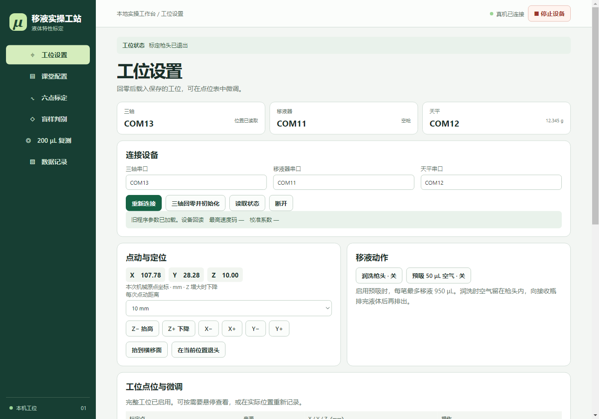
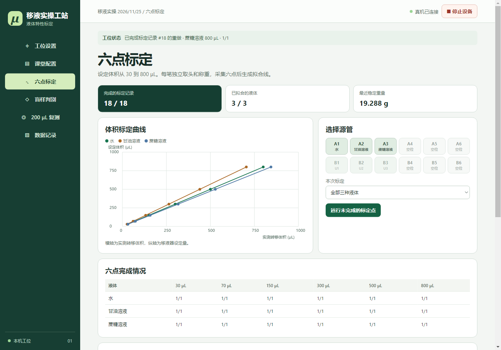

# 移液实操工站

在这台 Windows 工位电脑上双击 **启动实操.cmd**。浏览器打开中文工作台。三台设备通过本机串口工作，课堂页面、计算和数据文件均在本机。

| 到台面时的情况 | 从这里开始 |
|---|---|
| 第一次使用，天平排液位尚未保存 | [首次设置工位](#首次设置工位) |
| 天平接收瓶位置已保存，台面布置与上次一致 | [日常开课](#日常开课) |
| 正做到一半，出现后重超时、掉线或停机 | [处理暂停的记录](#处理暂停的记录) |

这台电脑已完成首次工位标定。接收瓶本次现场记录为 **X 278.25、Y 91.10、Z 70.00 mm**，其余点位沿用旧工位。台面布置相同时可直接按“日常开课”操作。以后重新记录时，以页面显示的最新坐标为准。

## 启动与连接

1. 找到和本文件在同一目录的 **启动实操.cmd**，双击，保留启动窗口。浏览器未弹出时，点击[打开本地工站](http://127.0.0.1:8765/)。重复启动可回到同一服务。
2. 在左侧选 **工位设置**。核对三轴为 **COM13**，移液器为 **COM11**，天平为 **COM12**。如果电脑重新分配过端口，可以在页面改这三格。
3. 点击 **连接并检查**。程序读取三个轴的当前位置、枪头传感器状态和天平的新鲜稳定重量。看到 **三台设备通信正常** 后继续。若某口被占用，先关闭占用它的串口调试工具。
4. 停稳后卸下枪头并确认回零路径畅通。点击 **三轴回零并初始化**。Z 先向上寻负限位，随后 X、Y 分别寻负限位，每个轴退离 10 mm。程序每 0.2 秒检查一次位置，收到负限位信号或发现位置已持续稳定 1 秒，就自动记录该轴原点并退离。每轴寻限位最多 30 秒。通信异常、明确碰撞或寻限位超时会停止初始化。三轴全部到位后加载移液器参数。点击 **读取状态** 可重读三轴、枪头和天平。

本机使用 Python 3.10 或更新版本与 pyserial 3.5。课堂时双击即可。若移到其他工位电脑，先安装带 Python 的 Windows 运行环境，并在项目目录打开终端运行 `python -m pip install -r requirements-rs232.txt`。也可用 `python -X utf8 workshop.py` 启动。浏览器使用 Edge 或 Chrome。

## 首次设置工位

枪头盒是 8 行 × 12 列，编号 A01–H12。样品架是 2 行 × 6 列，使用同款 15 mL 试管，编号 A1–B6。天平接收瓶留在称盘上，废头容器开口放在原 30 管架 **C03** 上方。让容器在整个验收过程中保持固定。

**第一次只需标定天平接收瓶。** 两个架的全部孔位、横移高度及 C03 弃头位已按旧工位载入。“工位点位与微调”表中可看到每个点的来源。测量使用本次物理回零后的毫米坐标。回零退离后，页面显示约 X=10、Y=10、Z=10。

1. 在“枪头盒”核对实际下一支新枪头。点击 **取标定枪头**，设备按旧点位取一支并抬到横移面。若枪头已装好，可以直接定位接收瓶。
2. 用 X、Y 点动让枪头对准接收瓶开口。再用 Z 点动到排液高度。**Z− 抬高，Z+ 下降**，接近瓶口时选 0.5 或 0.1 mm。记录时枪头与瓶壁、称盘留有间隙。手动 X、Y 点动会在当前高度移动。若枪头仍在瓶内，先点 **抬到横移面** 再跨瓶移动。
3. 在 **工位点位与微调** 找到“天平 · 瓶内排液位”，点该行的 **记录** 或 **重新记录**。在“枪头盒”点 **到 C03 退标定头**。本机保存这个瓶位，下次开课直接载入。

旧工位的横移 Z 为 10 mm。枪头 A01 的 X/Y/Z 为 58.89 / 161.48 / 172.00 mm，其中 172 mm 已含原程序的 10 mm 取头下压。试管 A1 的吸液位置为 55.39 / 95.68 / 158.00 mm。枪头盒按 9.0 mm、试管架按 21.8 mm 排布。C03 弃头位置为 107.78 / 28.28 / 128.00 mm，采用原 C03 的孔心与旧程序的带头退头高度换算。

以后移动了架子或容器，可以用 **到上方** 在横移面查看位置，并在实际位置点 **重新记录**。枪头 A01 记录压紧后的最终 Z，试管 A1 记录带头吸液深度。每个架另两个角点只用于 X、Y。保存的微调优先于初始值。

**枪头从哪里开始取**　在“枪头盒”中检查下一孔。首次用掉 A01 标定时，系统会把本盒下一孔推进到 A02。取用顺序为 A01、A02 … A12、B01 … H12。换入整盒新枪头后，选择 A01 并点击 **登记盒内起始孔**。每笔预留的孔位会保存在本机，刷新页面或重启服务后仍然有效。

## 日常开课

1. 在 **工位设置** 查看状态。若已连接并显示“完整工位已启用”，核对枪头盒的下一孔后即可进入课堂。新启动服务或设备重新上电时，先连接，空枪执行 **三轴回零并初始化**，用保存的瓶位开课。若当天移动了接收瓶，先更新它的排液位。
2. 老师进入 **课堂配置**，填写课堂名称、每个标定点的重复次数、三种已知液的密度（g/mL）和六支样品对应的管位。重复次数默认为 1。为 U1、U2、U3 录入互不重复的真实身份。
3. 点击 **建立课堂并封存答案**，再把页面交给学员。本场设置随数据保存。以前的课堂可在页面底部打开。学员提交前，盲样身份在结果页和导出文件中保持隐藏。

### 三种已知液的六点标定

进入 **六点标定**，从管架图点选一种已知液，或选择“全部三种液体”。点击 **运行未完成的标定点**。六个设定量为 **30、70、150、300、500、800 μL**。默认每种液体六笔，共十八笔。再次运行时已完成的点会计入所需次数。

观察页面顶端的当前步骤。每笔取一支新枪头，读取稳定前重，从源管正式吸液，移到接收瓶排液。枪头离开接收瓶后读取稳定后重，保存数据，将枪头退到 C03。天平面板可以一直显示累计重量。

**工位设置 → 移液动作** 有两个独立开关，首次升级时均关闭，选择保存在本机。开启“润洗枪头”会在正式吸液前，按本笔设定量吸一次并排回源管。开启“预吸 50 μL 空气”会在源管正上方、下降前吸一次空气。润洗时空气留在枪头中。正式排液后，在接收瓶再排出这 50 μL 空气。开启预吸时单笔液量上限为 950 μL，关闭时为 1000 μL。

在“最近的逐笔记录”或“数据记录”中，点标定记录旁的 **重做** 即可用新枪头从同一管位按原设定量重测一笔。新笔成功后参与拟合，旧笔标为“已被重做”并保留原始重量。若重做中断，原有效笔继续计入曲线。导出文件可查重做对应的记录编号及每笔使用的开关状态。

页面保留每笔设定量、前重、后重、净增质量、密度、体积、管位和枪头号。每种液体收齐六个点及其规定重复后出现拟合线。把鼠标移到散点上可查看一笔的体积。下图展示软件验收用的演练数据。

### 三个盲样的判别

1. 三条曲线齐全后进入 **盲样判别**。选 U1、U2 或 U3，输入本次设定量和次数，点击 **执行这组盲测**。可以自由追加不同体积。设备接受 10–1000 μL 的整微升设定，30–800 μL 之外的判别涉及外推。
2. 查看每个盲样在三种候选液体下的质量偏差，单位为 mg。同一盲样的偏差越小，说明该候选越符合观察。接近时可先补测再判断。每个盲样至少有一笔有效记录后即可提交。
3. 为 U1、U2、U3 各选一个不同身份，点击 **提交并揭晓**。页面并排给出学员配对、教师答案和逐项结果。提交后本场配对锁定，原始测量记录保留。

### 三种已知液的 200 μL 复测

进入 **200 μL 复测** 查看三种已知液各自的计算结果。点击 **复测三种已知液**，系统从三支已知液试管分别重新移液。每种显示计算值、实际下发整数、实测体积、绝对误差和有符号相对误差。课程以实测并报告误差完成此环节。

### 保存成果

在 **数据记录** 点 **导出逐笔 CSV**，用 Excel 打开即可查看。**完整实验记录 JSON** 还包含每笔的工位快照、指令默认值、设备回读、原始称重帧、时间、步骤、三条拟合线和候选配对偏差。课堂历史与工位保存在 `data/workshop.sqlite3`，服务诊断日志在 `data/workshop.log`。需要备份时，结束动作并断开设备后关闭服务，再复制 `data` 目录。

## 处理暂停的记录

| 页面或现场情况 | 该做什么 |
|---|---|
| 串口打开失败、状态查询超时 | 核对串口号以及其他软件是否占用，确认连线和电源，再点 **重新连接**。空枪执行 **三轴回零并初始化**，系统会重新载入工位。 |
| 未确认取头、动作回执丢失、断电中断 | 查看最后动作和枪头孔号。由现场人员核对枪头、接收瓶和机械位置，在废头位处理已用枪头。动作结果不明的记录选 **核对后作废本笔**，随后安排新测量。 |
| 已排液，后重超时 | 保持接收瓶原状，确认枪头已离开瓶口。点 **仅补读后重**，程序只取新的稳定重量，再完成退头。若瓶子已移动、又加入液体或条件已改变，作废该笔。 |
| 重量已保存，退头中断 | 检查 C03 和已装枪头。在工位已核对时点 **完成本笔退头**。若重新连接时仍带头，请先由现场人员在停稳状态下处理枪头，然后补完该笔，空枪执行三轴回零并初始化。 |
| 枪头用完 | 换入新盒并登记新盒起始孔。标定和复测可直接继续未完成项。盲样页按已有记录决定要追加的笔数。 |
| 路径异常或有碰撞危险 | 点击顶部 **停止设备**。软件停止后续步骤并向三轴发送停止命令。移液器正在执行的吸排可能已生效。出现现实碰撞危险时由现场人员使用设备停机或断电措施。恢复前核对实物、重新连接并确认工位。 |

稳定称重沿用本机验证过的读取器。取连续 5 帧 ST，窗口最大差不超过 0.002 g，相邻帧间隔不超过 0.5 秒，使用最新一帧。每次称前后重都等待新数据。显示分度为 0.001 g，小体积点的相对波动会更明显。

## 计算与验收对照

- 每笔净增质量 `Δm = 后重 − 前重`。实测体积 `x = 1000 × Δm / ρ`，其中质量用 g、密度用 g/mL、体积用 μL。
- 每种液体用成功标定笔的原始点做带截距线性回归 `q = a × x + b`。横轴是实测转移体积，纵轴是移液器设定量。
- 盲样在设定量 q 下，候选液体的预计增重为 `ρ × (q − b) / a` mg。对照实际净增的 mg，汇总该盲样多笔的均方根偏差。三管共有六种一一配对。若前两种配对的差距接近天平分度或标定残差，页面提示可追加测量。
- 200 μL 对应的设定为 `a × 200 + b`，四舍五入到整微升。绝对误差为 `|实测 − 200|` μL，相对误差为 `(实测 − 200) / 200 × 100%`。
- 一次新手验收应能完成首次标定、重开后使用保存工位、三条六点曲线、三份盲样配对和三笔独立 200 μL 复测，并用导出记录复算结果。若每种盲样测一笔、各标定点测一笔，正式实验共 **24 笔**，另计标定试用的枪头。

## 代码与本机来源

三轴速度可在 `workstation/layout.json` 的 `motion` 中调整，重启服务后生效。自动跨点位时，先将 Z 抬到横移面，再连续下发 X、Y 指令，让两轴同时移动。两个轴均确认到位后，Z 以常规速度降到目标。常规 XY 和手动点动的目标速度为 50 mm/s，按整数转速下发 38 rpm。XY、Z 上限分别为 38 和 300 rpm，加速度为 500 rpm/s。

| 动作 | X、Y 指令速度 | Z 指令速度 |
|---|---|---|
| 回零寻限位、退离 10 mm | 37 rpm（约 49.3 mm/s） | 300 rpm（25 mm/s） |
| 常规移动、手动点动 | 38 rpm（约 50.7 mm/s） | 300 rpm（25 mm/s） |

工站使用 Python 标准库本地服务、SQLite、pyserial 与浏览器原生页面。`workstation/geometry.py` 和 `workstation/layout.json` 管理坐标，`hardware.py` 管理设备，`control.py` 管理动作，`science.py` 管理计算，`store.py` 管理记录。天平直接使用项目原有的 `rs232_scale.py`。

首次工位来自旧实验图 `greenlab_electrochem_01.json`、`electro_deck.json` 和旧设备程序中的动作高度。两个架的孔心、取头下压、带头吸液和退头高度都已换算到同一机械原点。`workstation/legacy` 中的 Modbus 三轴驱动和串口总线源自本机 Uni-Lab-OS-xyf1 的 LaiYu 驱动，附带原许可证。本版校验写入确认，并只重试读指令。SOPA 使用旧程序地址 4 和原参数组，要求完整校验帧与动作完成回执。原始参数码与设备回读分别记录。

开发者可以运行 `python -m unittest -v test_rs232_scale test_workstation`。课堂逻辑测试使用临时数据库和测试设备，正式工位通过实物核对和实际称重验收。
